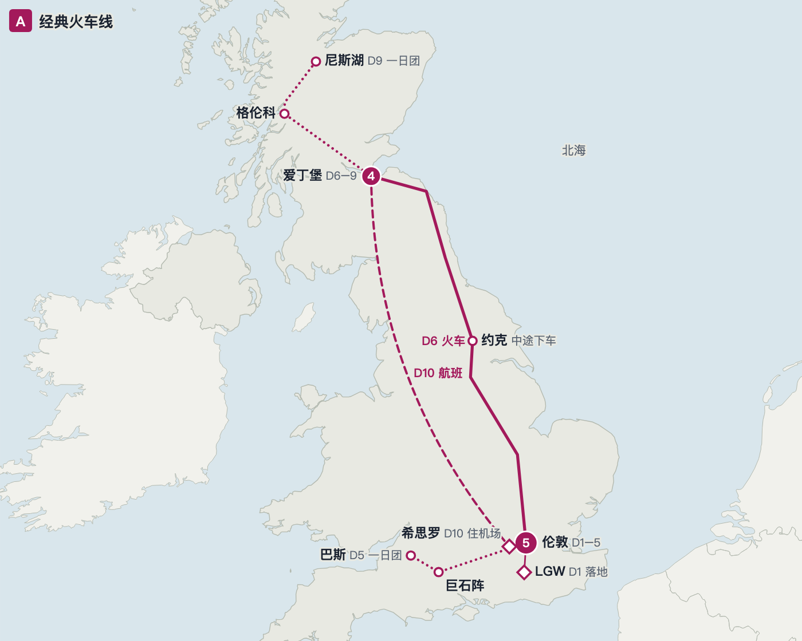
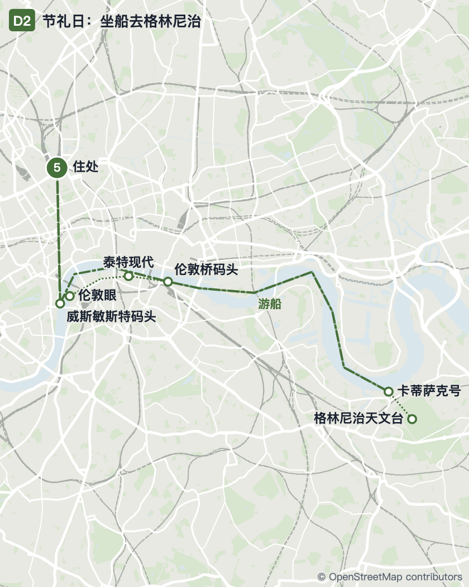

# travel-skills

三个 [Claude Code](https://code.claude.com) / Claude 技能，把会话里**已经定好**的行程变成看得见的东西。制定行程本身不在范围内。

| 技能 | 做什么 | 输出 |
|---|---|---|
| [`trip-route-map`](skills/trip-route-map/SKILL.md) | 把一个或几个路线方案画在真实底图上，每个方案（或每天）一张小图：住几晚、日期、途经景点、交通方式。国家尺度用 Natural Earth 海岸线，城市尺度用 OpenStreetMap 街道 | HTML（浅色/深色）、嵌入用片段、每个方案一张 PNG / SVG、整页 PDF |
| [`landmark-photos`](skills/landmark-photos/SKILL.md) | 给每个景点找一张经典照片（维基百科首图 / Wikimedia Commons），按路线或城市分组排成小图墙，保留作者和许可；读者对目的地不熟时，改成带「是什么 / 为什么去 / 适合谁」解说的卡片 | HTML、嵌入用片段、一张长 PNG、PDF |
| [`travel-journal-prompt`](skills/travel-journal-prompt/SKILL.md) | 旅行结束后，根据会话里的行程写一段交给 ChatGPT 图像生成（或其他图像模型）的 prompt，画一张手账风旅行报告：路线地图、景点插画加第一人称感想、美食、票根邮票。默认日语，景点名附当地文字，用当地纹样和工艺做装饰 | 一段可直接粘贴的 prompt（不生成图片） |

| 国家尺度 | 城市尺度 |
|---|---|
|  |  |

前两个技能只用 Python 标准库；PNG / PDF 需要本机有 Google Chrome 或 Chromium（也可以用环境变量 `CHROME` 指定路径）。

## 安装

### Claude Code：从插件市场装（推荐，能跟着仓库更新）

```bash
claude plugin marketplace add b-z/travel-skills
claude plugin install travel-skills@travel-skills
```

装好后技能名是 `/travel-skills:trip-route-map`、`/travel-skills:landmark-photos` 和 `/travel-skills:travel-journal-prompt`。平时不用手动调用，会话里说"把这几个方案画在地图上""把景点照片列出来""写个手账 prompt"，Claude 会自己用。

### Claude Code：只拷一个技能

```bash
git clone https://github.com/b-z/travel-skills.git
cp -r travel-skills/skills/trip-route-map ~/.claude/skills/
```

放进某个项目的 `.claude/skills/` 则只在那个项目里可用。

### claude.ai / Claude 桌面应用

把 `skills/` 下的某个文件夹打成 zip，在 claude.ai 的 **Customize → Skills → + → Upload a skill** 上传。Team / Enterprise 组织的管理员开启技能共享后，可以在技能页点 **Share** 分享给同事或整个组织。网页端的代码执行环境需要能访问外网（下载底图、维基和 Commons），否则技能跑不起来。

## 素材许可

- 代码：MIT。
- 底图：[Natural Earth](https://www.naturalearthdata.com)（公有领域），通过 [world-atlas](https://github.com/topojson/world-atlas) 获取；城市底图 © [OpenStreetMap](https://www.openstreetmap.org/copyright) 贡献者（ODbL），通过 Overpass API 获取。
- 照片：来自 Wikimedia Commons，各自的作者和许可由脚本写进输出的署名列表。CC BY / CC BY-SA 的照片使用条件就是署名，分享时请保留这份列表。
